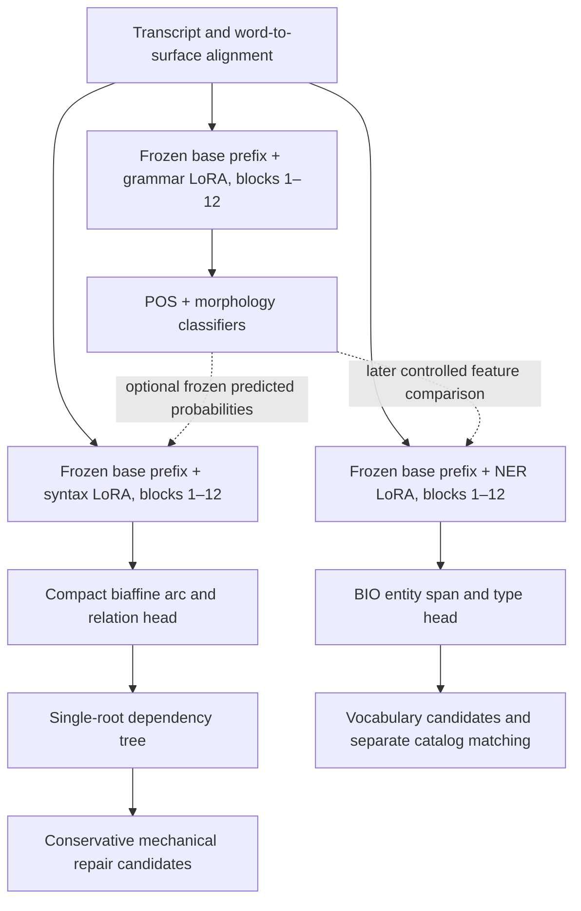

# Multilingual syntax, grammar and NER training plan

**13 October 2026 — reviewed plan, now backed by the implemented research pipeline. Integrated smoke tests have run; full campaign training has not started.**

## One-page executive summary

**Goal.** Produce small English/French/Spanish task adapters for mmBERT: dependency trees for hesitation analysis, POS and morphology for grammatical context, and named-entity spans/types for vocabulary candidates. The model supplies structured predictions; a separate, conservative program decides whether to delete an earlier formulation or propose a vocabulary replacement. The latest formulation must survive.

**Architecture.** Keep the original pretrained mmBERT-small weights frozen. Read the raw output of block 12 and train rank-4 attention LoRA plus small task heads. Use one multilingual adapter per task path: grammar, syntax, and NER—not one adapter per language. POS and morphology share the grammar adapter. Syntax still uses a compact **biaffine head**; LoRA and biaffine are complementary components. Separate adapters require separate encoder paths, even when they share stored base weights.

**Why these choices.** At five matching English training epochs, block 12 beat block 11 by **0.80 LAS points on English500 and 0.90 on GUM**. A layer-mixture pilot did not justify its complexity; block 13 failed the improvement gate. A shared EN/FR/ES adapter improved English over an English-only control at the same English exposure, although it used more total compute. An explicit language feature had no consistent benefit. These results support our next baseline; they do not establish a universal best architecture or trained Catalan support.

**Data.** Start with a reproducible core of **3,000 ordinary UD training sentences per language**. Reuse the established EN/FR/ES selection; defer Catalan to a later campaign. The adjudicated dataset contributes **688 training candidates, 152 development cases and 168 regression-test cases** to this campaign. Catalan, diagnostic-only and unresolved rows remain outside its training manifest. Its labels are AI-reviewed proposals, and it is not a POS/morphology/NER corpus. NER needs its own multilingual span/type annotations.

**Training sequence.** First fit grammar for five epochs and freeze it. Screen syntax with versus without its predicted POS/morphology features for two matched epochs; continue the selected architecture to epoch five. Then branch the same syntax checkpoint into **two additional epochs with approximately 10% hesitation examples**, versus an equal-step ordinary-UD control. Keep the reviewed repair/KEEP proportions. Train fixed-category NER separately for three epochs once its data is ready; allow a predeclared two-epoch extension only if development results support it. Use seeds 42 and 43; evaluate and save a full resume every epoch.

**Optimization.** Retain the working AdamW recipe: head learning rate 0.001, LoRA 0.0001, weight decay 0.01, batch 16 and gradient clipping at 5. Keep learning rates constant in the first campaign. Do not introduce a new scheduler, rank search or joint multitask objective while testing multilingual transfer and hesitation supervision.

**Success.** Report each language, each seed, ordinary parsing accuracy, repair accuracy and harmful changes separately. Protect KEEP examples, negation and latest spans. Judge NER by exact spans/types and false candidates, not token accuracy. Existing synthetic holdouts are regression evidence; new real-dictation confirmation is required before deployment. No numerical Stanza-parity or production-safety promise follows from the present results.

**Implementation.** The [campaign package and runbook](campaign/README.md) now provide the frozen EN/FR/ES manifest, masked grammar training, both syntax branches, hesitation/control continuation, automatic deletion scorer and gated NER path. See the [implementation and validation report](MULTILINGUAL_PIPELINE_IMPLEMENTATION.md). The budget remains **18,552 updates before NER**. Full training has not started; COSER model evaluation remains untouched. Reviewed multilingual NER data is still a prerequisite.

---

## 1. What we will train—and what a trained model will do

The selected base is `jhu-clsp/mmBERT-small`, pinned to revision `abc32620dd4f6ab06f5fbe905dc25f310618e09f`. Block 12 means the output **after the twelfth transformer block, before final normalization**, not zero-based index 12. Mean-pool its subwords into words, preserving the historical half→float pooling convention for comparable results.



The three paths share the same immutable base **parameters**, not interchangeable hidden states. LoRA changes representations from the early blocks onward. Do not add independently trained adapters together or claim that this architecture computes all three tasks in one prefix pass. A frozen grammar teacher can be cached during training and reused at inference when already requested; its real computation and alignment costs still count.

| Package | Trainable components | Supervision | Starting state |
|---|---|---|---|
| Grammar | Fresh block-12 LoRA; UPOS classifier; one classifier per selected morphology attribute | Ordinary UD tags/features with observation masks | Original pretrained base; fresh adapter and classifiers |
| Syntax | Fresh block-12 LoRA; compact biaffine head; optional small grammar projection | UD heads/relations, then reviewed hesitation trees | Original pretrained base for initial fit; exact full-state continuation for adaptation |
| NER | Fresh block-12 LoRA; linear BIO classifier; optional grammar projection in a separate comparison | Reviewed entity spans and operational types | Original pretrained base; fresh adapter and head |
| Mechanical repair | No learned rewrite head in this campaign | Scored output/deletion cases | Explicit, versioned policy over predicted structures |

“Fresh” never means randomizing mmBERT itself. The existing English checkpoints remain baselines; loading their eleven-block adapters into this new twelve-block experiment would change the question. Each task package starts fresh, while later epochs of that package resume normally.

The current twelve-block syntax package has **110,592 LoRA parameters + 321,190 head parameters = 431,782 trainable parameters**, about 1.73 MB in raw float32 tensors. This excludes the required base weights, optimizer state, tokenizer and runtime. Rank-4 LoRA is not QLoRA: quantization is not part of the present recipe.

**Lemma scope:** keep the existing lemma implementation as a reference, but do not require a new multilingual lemma package in this campaign. The earlier syntax feature experiment combined POS, morphology, lemmas and auxiliary losses; it did not prove that each component was necessary. The first new feature comparison deliberately tests POS/morphology only. Adding lemma prediction later requires its own multilingual inventory, missing-label masks and evaluation.

## 2. How we reached the current decisions

| Decision | Actual local evidence | Interpretation and limitation |
|---|---|---|
| Prefer LoRA plus a compact biaffine parser | Existing syntax-only training adapts attention with small trainable matrices and learns arc/relation scores in `ParserHead` | “LoRA versus biaffine” was imprecise shorthand. The large standalone head and compact LoRA model differed in training history; we have not proved a controlled universal superiority claim. |
| Use block 12 | At epoch 5: English LAS 88.56→89.36; GUM 89.24→90.14 for 11→12 | One seed, matched data/order/epochs, previously observed development sets. The practical comparison also adds one adapter block. |
| Stop searching deeper for now | Block 13 versus 12: English −0.21 LAS points, GUM approximately unchanged; gate failed, so no block-14 run | This is a bounded screening result, not a proof that 12 is the global maximum. |
| Do not use the tested layer mixture | Frozen raw8/11 readout experiment averaged −0.55 LAS points and failed its repair/KEEP criterion | This was a frozen-adapter probe, not a fresh-LoRA mixture comparison. |
| Shared multilingual syntax, initially no language ID | Language feature mean LAS effects: EN +0.03, FR −0.04, ES −0.12 points across two seeds | No consistent benefit for this specific feature. Missing/wrong hints also hurt some results. |
| Preserve English and expand languages | Shared EN/FR/ES versus matched-English-only: +1.04 English LAS and +1.68 GUM points on average | Equal English exposure, **unequal total updates and compute**. French/Spanish specialist controls were not trained; Catalan was absent. |
| Test grammar features rather than assume them necessary | English explicit-feature package at epoch 5: +0.57 English LAS and +0.26 GUM versus context-only | One seed, block 11, combined POS/morph/lemma and auxiliary objectives. A frozen multilingual POS/morph teacher is a new intervention. |
| Keep grammar training independent from hesitation adaptation | Existing English teacher: UPOS 95.91%, morphology bundle 93.55%, positive morphology F1 94.77% | Good English development results; not multilingual validation. A separate teacher prevents synthetic syntax updates from silently changing tag predictions. This separation is a new engineering choice. |
| Use fixed-category NER first | Context→grammar-feature mean typed F1 67.22→68.14; span F1 82.31→85.23 | Weak synthetic English data; typed seed variability exceeds the feature gain. No proof grammar inputs improve multilingual NER. |
| Defer arbitrary-label NER | GLiNER-style v2 seen/unseen typed F1 approximately 25.06/20.23 at development-selected thresholds | A feasibility pilot with weak labels and false-positive/recall tradeoffs, not GLiNER parity. |

Block 11 was our inherited experimental starting point. The available reports do not establish that its original selection came from a systematic optimum search. Block 12, in contrast, has a recorded comparison. We should preserve that distinction rather than retrospectively invent a rationale.

Evidence: [layer-12 continuation](SYNTAX_LAYER12_VS11_EPOCHS5.md), [13/14 gate](SYNTAX_LAYERS_13_14_ONE_EPOCH.md), [mixture pilot](SYNTAX_LAYER_FAST_SIGNAL.md), [language-feature comparison](MULTILINGUAL_LAYER12_LANGUAGE_FEATURE.md), [matched English control](ENGLISH_ONLY_MATCHED_MULTILINGUAL_CONTROL.md), [grammar features](LORA_EXPLICIT_GRAMMAR_EPOCHS5.md), [POS/NER audit](POS_NER_LAYER_SELECTION_PLAN.md), [fixed NER](NER_POS_MORPH_ABLATION.md), [label-conditioned NER](GLINER_STYLE_NER_NEGATIVES_V2.md).

## 3. Data contract and sampling

### 3.1 Ordinary grammar/syntax core

The first campaign uses the established EN/FR/ES small multilingual recipe. Catalan is deferred: its reviewed rows remain preserved, but none enters grammar, syntax or NER training in this campaign.

| Language | Proposed unique UD training rows per epoch | Composition/status |
|---|---:|---|
| English | 3,000 | Reuse 1,500 EWT + 1,000 GUM + 500 ESLSpok |
| French | 3,000 | Reuse 1,800 GSD + 600 Rhapsodie + 600 ParisStories |
| Spanish | 3,000 | Reuse AnCora selection; preserve COSER as evaluation-only |

Freeze exact identities, source revisions, source hashes, exclusion lists and per-epoch batch plans. Exclude official dev/test and all protected local evaluation content. Check normalized text and repair targets, not just record IDs. Keep translated families together across languages; a French training translation of an English test family is leakage even when strings differ.

Each language gets 188 homogeneous batches at batch size 16: 187 full batches and one batch of eight. Interleave these for **564 updates per epoch**, with each ordinary row seen once. This balances sentence/batch counts, not token counts; report words, subwords and reparandum edges separately. Long AnCora sentences still differ from short spoken examples. Do not silently rebalance by duplicating only easy sentences.

Use ordinary development pools of up to 500 eligible sentences per language plus the historical separate GUM regression set. Use French Rhapsodie/ParisStories and English ESLSpok/GUM **development** splits for natural-speech checks during development; never substitute training rows. Keep original heldouts locked. The small-core results will not be a fair comparison against the older 23,957-row English model.

After this campaign identifies a viable recipe, expand ordinary UD coverage in a **separate scale-up run**. Use available protected train pools and a documented language sampler, with an exposure-matched control if claiming the benefit of extra languages. More epochs over 3,000 rows are not equivalent to using the additional available constructions. This plan finishes a reproducible research candidate before claiming a final production model.

### 3.2 Reviewed hesitation supervision

Use only `syntax-candidates/<language>/<split>.json` from [adjudicated v1](artifacts/hesitation-multilingual-adjudicated-v1/README.md):

| Language | Train repair / KEEP | Train total | Dev | Regression test |
|---|---:|---:|---:|---:|
| EN | 125 / 108 | 233 | 58 | 58 |
| FR | 121 / 106 | 227 | 47 | 55 |
| ES | 120 / 108 | 228 | 47 | 55 |
| **Active EN/FR/ES** | **366 / 322** | **688** | **152** | **168** |
| CA — deferred | 121 / 106 | 227 | 47 | 45 |
| Entire preserved dataset | 487 / 428 | 915 | 199 | 213 |

The active campaign has 688 training rows, not 688 independent source situations: translations and variants share families. The preserved four-language dataset has 1,327 full-tree candidates across all splits, of which 915 are training rows. EN/FR/ES training has only 29/27/29 families respectively; report results and repetitions by family. Preserve IDs, family locks, split assignments, latest/negation spans and surface-to-UD mappings. Select `syntax_training_eligible`, not just a REPAIR label. Do not use diagnostic-only, unresolved, or the separate Catalan replacement proposal as full-tree supervision.

The import retains `training_ready=false` and `active_training=false`. Execution will create a **new training manifest that explicitly selects these candidates as reviewed weak syntax supervision**, without rewriting their provenance or claiming human-gold status. This is an intentional promotion step in the future harness, not a flag we silently flip in the source data.

No complete gold POS/morphology/lemma labels are available for these rows. Their partial `pos_candidates` must not be treated as complete UD annotation. Train syntax on their trees; mask missing auxiliary labels. NER spans cannot be inferred from them.

### 3.3 Grammar inventory

Use the standard 17 UPOS classes. Retain Number, Person, Tense, VerbForm, Mood, Degree and Voice; **add Gender** for the proposed three-language grammar package. Build attribute values from training data only. This expands the prior English schema, so score the original seven separately as well as the new full bundle. It is a product coverage decision, not a claim that Gender was responsible for earlier gains.

Keep a treebank/token annotation-coverage mask. Distinguish an annotated token with an absent attribute from an unannotated token/treebank. Preserve a canonical multi-valued attribute value instead of silently dropping one component. Unknown evaluation values count as uncovered/errors in reporting; do not remove difficult tokens from metric denominators. Audit rare values per language. Other attributes such as Polarity or PronType can be listed as out of scope until deliberately added.

### 3.4 NER has a separate data requirement

Keep five operational types: `person`, `vendor_platform`, `project`, `location`, `product_tool`. Write a short policy for ambiguous cases such as a company versus its product, and project names that look like places. “Vercel” and “Redrock” cannot be disambiguated reliably from name shape alone. Preserve uncertain annotations; do not invent a type from a vocabulary-list match.

The existing English pilot has **672 training views from 168 base groups**, 172 dev views and 252 test views. These are four variants per group, not hundreds of independent natural conversations. It is not a ready multilingual training set.

Planning target for EN/FR/ES only: **800 train + 100 dev + 100 new confirmation base contexts per language**, before augmentation. Retain roughly 25–35% genuine entity-free/hard-negative contexts, and cover each type, common-word/name collisions, multiword names, ASR fragments and unseen names. Use public annotations only where their type definitions actually map; a generic ORG label does not establish `vendor_platform` or `project`. Supplement with reviewed engineering/dictation examples. Record which examples are natural, synthetic or audio-verified; synthetic corruptions are not evidence of real ASR behavior.

Split by session/source, name-and-alias family and template; translations and augmentations remain in the same split. In partially annotated public data, mask unknown regions instead of training them as `O`. If this data is not ready, grammar and syntax can proceed, while NER remains a bounded prototype.

## 4. Training stages and epoch strategy

### Stage 0 — prepare and verify, without training

Create a versioned EN/FR/ES corpus and protocol. Record the exact architecture, data, software versions, seeds, budgets and gates below before examining new metrics. Verify CoNLL-U words, contractions/clitics, head bounds, single roots, acyclicity, labels, offsets and subword coverage. The existing encoder limit is 256 subwords: reject and count overlength examples; never truncate a tree. A future long-input strategy is a separate change.

Replay existing checkpoints on their original rows to establish evaluator parity. Test the new eight-attribute masks, block-12 routing and resumed next-update equivalence. Treat code smoke runs as disposable preflight, not extra hidden training of the comparison models.

### Stage G — multilingual POS/morphology, five epochs

Train fresh grammar LoRA and tag heads for seeds 42 and 43. Use ordinary UD only. Primary loss:

```text
L_grammar = CE_UPOS + mean(CE_attribute for attributes observed in this batch)
```

Mask missing targets; if none of the morphology attributes is observed, its term is differentiable zero. Log each component and its number of supervised tokens. Five epochs means five complete ordinary-core passes: **2,820 updates per seed**. Save/evaluate each epoch; epoch five is the fixed comparison endpoint. Stop early only for invalid data, nonfinite training or a predeclared runtime guard—not to hide a bad curve.

Freeze both epoch-five teachers. Pair seed-42 syntax/NER with teacher 42, seed 43 with teacher 43. Cache predictions with keys covering teacher hash, inventory, ordered words, alignment and augmentation identity; text alone is insufficient when tokenization differs. Teacher outputs are predictions from the input, never gold features. Report that training-row teacher predictions are in-sample; a large train/dev feature gap would justify a later out-of-fold teacher study.

### Stage S — syntax baseline and grammar-feature screen, epochs 1–5

For each seed, initialize two identical fresh syntax adapters and heads:

1. **Context-only:** raw block-12 word states into the biaffine head.
2. **Frozen grammar features:** the same states plus a zero-initialized linear projection of frozen predicted UPOS/morphology probabilities.

The probability-vector width is derived from the new inventory; **do not hardcode the old 43 dimensions**. Keep the teacher frozen. Both arms optimize only arc CE + relation CE; neither adds an auxiliary grammar loss. Match initial syntax weights, batch order and head-dropout RNG. This is intentionally different from the earlier jointly trained lemma-feature experiment.

Run exactly two epochs in all four models: **1,128 updates each**. Select the feature architecture only if its mean macro-language LAS improvement is at least **0.20 percentage points**, the macro effect is positive in both seeds, and no language loses more than **0.50 points in either seed**. Otherwise choose context-only. These are practical engineering gates, not significance claims. Report paired feature-minus-control effects for each seed, their mean and paired sentence-bootstrap intervals, including macro and per-language effects. Do not require the gain to exceed overall seed spread. If uncertainty leaves a borderline benefit, label the result inconclusive and retain context-only rather than declaring superiority; the frozen protocol must specify the uncertainty decision rule before training. A third confirmation seed would require a separately declared extension. Report teacher-inclusive latency descriptively; it is not an acceptance gate under the recorded owner preference.

Continue the selected architecture's **two existing seed checkpoints** through epochs 3–5 with exact optimizer/RNG restoration. Do not restart from the favorable seed. Save the losing arm's epoch-two results; do not automatically spend three more epochs on it. Endpoint five is fixed, and the architecture selection on development data is disclosed. A late-emerging feature advantage could be missed; this is the accepted cost of the bounded screen.

Do not add casing/punctuation augmentation during G/S in the first campaign. These establish an interpretable ordinary-text baseline. NER's use of block 12 remains a chosen engineering default, not something the syntax comparison proved for NER.

### Stage H — hesitation adaptation, epochs 6–7

**Hard prerequisite:** implement, test and freeze the automatic candidate/deletion scorer before starting H. It must discover candidates from predicted trees without gold earlier/later pairs. Demonstrate KEEP preservation, latest-span survival and protected negation on worked cases; keep the known-pair-assisted metric separately labeled. If this scorer is absent, do not start H.

For each syntax seed, fork its epoch-five full resume into a hesitation arm and a matched ordinary-UD control. The grammar teacher remains frozen.

Per language and per epoch, retain all 188 ordinary batches and insert **21 full batches of 16 local rows**: 336 local exposures beside 3,000 ordinary exposures. Across three languages this is **627 updates and 10,008 sentence exposures per epoch**, of which 1,008 (**10.07%**) are local. Over two epochs this averages approximately 2.9–3.0 exposures per local row. This starts conservatively given the limited family diversity; a 20% comparison is a conditional future experiment, not part of the current budget.

Cycle through shuffled local rows so every eligible row appears before another cycle begins. Preserve each language's reviewed repair/KEEP proportions; do not force 50/50 or oversample only repairs. Record exact repeats and per-family exposure. The control replaces the same 21 batch slots with ordinary rows from the same language, preserving batch size and update count. Sequence lengths differ, so total FLOPs/dropout tensors are not perfectly matched; disclose that limitation.

Run **exactly two further epochs**, retaining the existing learning rates and AdamW state: 1,254 extra updates per branch. This measures replacing repeated ordinary supervision with hesitation supervision at the same step budget. The loss remains tree supervision; no deletion target is smuggled into the parser head.

### Stage A — bounded casing/punctuation variation during H

Precompute a deterministic augmentation manifest for H before training. For eligible rows choose one view per exposure: **50% original, 25% lowercase, 25% punctuation-reduced**. Apply the same ordinary-row policy in both H arms. Keep names' lexical content, accents, apostrophes, clitic hyphens and other lexical punctuation intact. These percentages are proposed defaults, not previously optimized results.

Deletion of punctuation changes token numbering: remove only permitted punctuation tokens, rebuild heads/offsets/spans, and validate again. An automatic UD transform may remove leaf punctuation only; a punctuation head with retained children needs an explicitly validated reattachment or the view is rejected. Rejected augmentation slots revert to the original view and are counted. Do not add punctuation randomly or substitute one linguistic reading for another.

Critically, punctuation can disambiguate a correction from contrast. An unpunctuated “no” version is **not automatically label-preserving**. Use the reviewed variant where it exists; otherwise require an explicit invariant-label rule or keep that sentence unchanged. Re-audit augmented normalized strings against heldouts. Recompute grammar predictions from the actual transformed input. If POS/morphology itself fails casing stress, plan a separate bounded grammar continuation; do not change the teacher halfway through H.

### Stage N — fixed-category NER, after its data gate

Train fresh context-only NER at block 12 for **three epochs, two seeds**, using the reviewed multilingual data and balanced language batches. Each word receives `O`, `B-type` or `I-type`: 11 labels for five types. Start with masked, unweighted BIO cross-entropy and the existing decoder; no simultaneous CRF, focal-loss or rank search. Match type/negative exposure through the data manifest, not by silently oversampling easy name lists.

Augmented views are regenerated deterministically from training contexts only, with checked source character spans. Never mark an ambiguous corruption as a verified entity identity. Choose any candidate-confidence threshold on dev, freeze it, and retain precision/recall curves. NER predicts span/type; catalog identity matching and replacement are separate evaluations.

Predeclare a conditional extension: if macro dev typed F1 improves by at least **0.50 points from epoch 2 to 3 in both seeds**, no language's typed F1 falls by more than **1 point**, and negative false-candidate rates do not rise, resume both seeds for **two additional epochs**. Otherwise stop at three and inspect data/errors. No sixth or seventh epoch is implied.

A frozen POS/morph NER arm is **optional follow-up**, using matched initializations and the same budget. Its earlier mean typed gain was too small and variable to make it mandatory. Require a repeatable dev benefit in typed and span metrics with no negative-case regression, and count its teacher cost. Arbitrary-label NER and lemma fusion stay outside this campaign.

## 5. Optimization and implementation references

| Choice | Initial setting | Reason / control |
|---|---|---|
| Base | Frozen, eval mode; original MLM untouched | Protect existing base behavior and isolate task adaptation |
| LoRA | Rank 4, alpha 8, `Wqkv` and `Wo`, blocks 1–12 | Working compact recipe; no new capacity search |
| Syntax head | Arc 128, relation 64, dropout 0.2; 37 base UD labels | Existing tested head/decoder; relation subtypes remain collapsed |
| Precision/backend | fp32 eager MPS, four CPU threads; historical pooled half→float cast | Preserve comparability; not mixed-precision training or quantization |
| Optimizer | AdamW, head/fusion LR 1e-3, LoRA LR 1e-4, decay 0.01 | Same parameter-group recipe as completed runs |
| AdamW details | Existing PyTorch defaults: betas (0.9, 0.999), epsilon 1e-8; explicitly serialize them | Prevent a library/config default from silently changing a continuation |
| Schedule | Constant LR, no warmup in initial campaign | Existing recipe worked; avoid introducing a scheduler confound |
| Batch and clipping | 16 sentences; global trainable gradient norm ≤5 | Known feasible; measure subword lengths and memory |
| Seeds | 42, 43; independent saved generators for data/augmentation | Report both, never only the winning run |
| Missing labels | Masked CE; observed absent feature has its own class | No fake morphology or entities from unannotated data |

A falling training loss alone does not justify more epochs. If ordinary dev scores plateau while training loss falls, inspect errors and broaden data. If a longer campaign is approved later, compare a declared lower LR or decay schedule in a new protocol; do not retrofit a schedule into one branch and call it a matched continuation.

**Existing LoRA implementation**, excerpt from [adapters.py](adapters.py):

```python
original = self.base(x)
if not self.enabled:
    return original
return original + ((x @ self.lora_A.T) @ self.lora_B.T) * self.scale
```

`lora_A` starts randomly, `lora_B` starts at zero, and `scale = alpha / rank`. The first forward therefore preserves the base output. Freezing base parameters does **not** mean wrapping the adapting encoder in `no_grad`: gradients must still reach the LoRA matrices.

**Existing block-specific pooling**, excerpt from `DepthFeatures.__call__` in [syntax_layers_10_11_12_v1.py](syntax_layers_10_11_12_v1.py):

```python
tokens, weights = self.inputs(rows)
hidden = prefix_states(
    self.model.model, tokens['input_ids'], tokens['attention_mask'],
    blocks=self.depth,
)
return torch.bmm(weights, hidden).half().float()
```

Use `depth=12`. Several legacy functions still default to 11; changing a config field without checking the forward path is insufficient.

**Design sketch**, retained to explain the training step. The executable implementation is now in [campaign/network.py](campaign/network.py), with data loading in [campaign/dataset.py](campaign/dataset.py) and checkpoint orchestration in [campaign/training.py](campaign/training.py):

```python
optimizer = torch.optim.AdamW([
    {"params": head_and_fusion_parameters, "lr": 1e-3},
    {"params": lora_parameters, "lr": 1e-4},
], weight_decay=0.01, betas=(0.9, 0.999), eps=1e-8)

# Base stays eval/frozen; syntax head is trainable. No no_grad around online().
optimizer.zero_grad(set_to_none=True)
states = online(rows)                       # explicit depth=12
if use_grammar:
    probabilities = frozen_teacher_cache(rows).detach()
    states = states + grammar_projection(probabilities)
arcs, relations = parser(states, mask, gold_heads=gold_heads)
loss = loss_for(arcs, relations, gold_heads, gold_relations, mask)
assert torch.isfinite(loss)
loss.backward()
torch.nn.utils.clip_grad_norm_(trainable_parameters, 5,
                               error_if_nonfinite=True)
optimizer.step()
```

The actual [model.py](model.py) computes relation loss on **gold parent edges during training**; at inference the single-root decoder predicts parents and labels. This is standard supervised factorization, not permission to provide gold heads to evaluation.

Reuse [multilingual_layer12_language_feature_v1.py](multilingual_layer12_language_feature_v1.py) for balanced language batch plans and checkpoint provenance, [syntax_layer12_continue5_v1.py](syntax_layer12_continue5_v1.py) for exact restoration checks, [lora_hesitation_reviewed_v2.py](lora_hesitation_reviewed_v2.py) for matched local/control exposure, and [ner_pos_morph_ablation_v3.py](ner_pos_morph_ablation_v3.py) for NER spans and frozen-feature comparisons. Do not run their old entry points unchanged: they encode old languages, inventories, block defaults and dataset schemas. The root `config.json` value of 15 epochs belongs to an older head-only trainer and does not define this plan.

## 6. Evaluation, checkpoint decisions and stopping rules

Save predictions and metrics after every epoch. Fixed comparison endpoints are G5, S2/S5, H7 and N3 or the predeclared N5 extension. Do not select a different epoch separately for each reported metric. If an earlier checkpoint must be retained after a failed gate, disclose that decision and keep the fixed-endpoint results visible.

| Task | Required measurements |
|---|---|
| Syntax | Non-PUNCT UAS and LAS by language and treebank; macro and micro; clean/lowercase/punctuation-reduced slices; natural reparandum exact-edge P/R/F1 |
| Grammar | UPOS accuracy; PROPN/NOUN and verb/auxiliary confusions; each morphology attribute, positive F1 and bundle exact; observed/unknown coverage; old seven versus all eight attributes |
| Hesitation | Exact repair edge and full abandoned subtree; automatic deletion exact match; harmful deletion on KEEP; latest and negation survival; abstention coverage; per-family results |
| NER | Exact character-span and typed P/R/F1; each language/type; unseen-name and noisy slices; false entity spans on negative contexts; annotation/alignment coverage |
| Runtime | Warm p50/p95 latency, memory, model loading, total active teacher+task path, alignment and decoding costs; failed/overlength input preservation |

The existing hesitation scorer is **known-pair-assisted**: it knows which earlier/later words to inspect. Retain that diagnostic, but label it clearly. Add a separately scored automatic candidate/deletion evaluator before making repair-safety claims. Parallel `obj`/`obl` roles or `parataxis` can identify candidates; neither alone authorizes deletion. Coordination, contrast and legitimate repeated complements must remain intact. A correctly predicted `reparandum` with a wrong subtree can still delete useful text.

Use gold UPOS to exclude PUNCT in ordinary UD evaluation. The synthetic corpus lacks complete gold UPOS: report its structural/deletion counts independently, and do not silently use predicted POS to change which synthetic edges are scored. Any punctuation-excluded synthetic metric needs a separately documented, audited token mask.

For H, proposed acceptance gates are: positive macro complete-repair improvement over the matched control in both seeds; no language losing more than 0.50 ordinary LAS points; no newly harmful KEEP deletions; and **zero latest-span or protected-negation deletions** on the scored cases. Report absolute counts and coverage alongside rates. The automatic scorer is a hard prerequisite, so these gates must be measured. During development, also inspect natural-repair P/R/F1 and exact counts on French Rhapsodie/ParisStories and English ESLSpok/GUM dev, comparing both the epoch-five parent and matched UD control. A decline triggers transfer-error analysis, not an automatic conclusion of template memorization.

For grammar, report retention relative to the old English teacher but do not call the 3,000-row/23,957-row comparison matched. Proposed research readiness requires stable per-language dev curves, ≥95% English UPOS and ≥93% English positive morphology F1, plus explicit results for FR/ES rather than guessed parity. These are provisional engineering screens, not guaranteed outcomes or substitutes for real speech evaluation. A failed core screen triggers corpus/error analysis before release.

**COSER endpoint-only check.** The pinned `es_coser-test` has 539 sentences and 164 natural reparandum edges. Keep it out of training, per-epoch evaluation, feature selection and sampling decisions. After the recipe and H endpoint are fixed, run one endpoint evaluation job comparing the frozen epoch-five parent, H7 hesitation arm and H7 UD control for both seeds. Record UAS/LAS, exact repair-edge P/R/F1, absolute counts and paired uncertainty. It can veto promotion; it cannot trigger tuning on the same test. An unresolved natural-speech regression blocks promotion pending analysis. Define the numerical veto policy in the frozen protocol before opening model results. Future tuning after exposure must treat COSER as regression evidence and obtain separate confirmation. It is not itself a gold automatic-deletion benchmark.

Bootstrap paired sentence counts for ordinary UD. Cluster hesitation resampling by original family **across languages**, and NER by source/session/name group. Report both seeds separately: seed variation is not covered by a sentence-bootstrap interval. Two seeds remain a small sample.

The active 152/168 reviewed hesitation partitions and historical English/GUM sets have already been examined. Treat them as development/regression sets, not fresh confirmation. Keep a new, locked real-dictation confirmation set outside all sampling and selection. A useful planning target is 100 repairs + 300 KEEP cases per language, including grammatical errors that should remain, ambiguous corrections, code-switching and technology names. Even zero harmful deletions in 300 independent keeps only supports an approximate 1% upper error bound; correlated cases weaken that assurance. Report the evidence available, not a universal “safe” percentage.

## 7. Reproducibility, execution and completion

Every epoch checkpoint must contain adapter/head/fusion tensors, optimizer parameter groups and moments, actual update count, epoch and batch cursor, CPU/MPS RNG, sampling/augmentation generator states, label inventories, base/tokenizer revision, data/protocol hashes and teacher hash. Save lightweight inference weights separately. Test one resumed next update against uninterrupted execution. Check the frozen-base hash and adapter-disabled MLM parity using the established same-device/fresh-CPU procedure.

Run one MPS training process at a time. Data audits and report preparation may overlap, but GPU contention makes timing and failure diagnosis harder. Benchmark the first 20 actual updates and include them in the declared budget. If projected epoch time exceeds 10 minutes, save a full resume and investigate backend, lengths or contention before continuing. Do not silently shrink batches, drop examples or change precision. Existing runs suggest minutes-scale epochs on this machine, but a grammar teacher, sentence-length distribution and new data can change the cost; publish measured estimates rather than a promised completion time.

The core syntax/grammar schedule is explicitly bounded:

| Stage | Runs | Updates per run | New updates total |
|---|---:|---:|---:|
| G1–5 grammar | 2 seeds | 2,820 | 5,640 |
| S1–2 feature screen | 2 arms × 2 seeds | 1,128 | 4,512 |
| S3–5 selected architecture | 2 seeds | 1,692 | 3,384 |
| H6–7 local versus UD control | 2 arms × 2 seeds | 1,254 | 5,016 |
| **Total before NER** | | | **18,552** |

These counts assume the frozen 3,000-row/language core and batch sizes above. Data-audit failures must revise the protocol **before** training. NER update counts are frozen after its independent corpus exists; its provisional row target is not an already prepared dataset.

Write each run to a new artifact directory with `protocol.json`, data manifests, per-epoch predictions/metrics, full resumes, verification results and a concise report. Notify at stage completion or a meaningful blocker; an unchanged running process does not need repeated status messages. A failed gate is an informative outcome, not permission to launch extra epochs indefinitely.

Implementation checklist (updated after the pipeline work; validation details are in the implementation report):

1. Implemented: frozen EN/FR/ES selection and reproducible treebank/attribute coverage masks. These masks infer availability from the pinned training annotations; semantic completeness still deserves reviewer scrutiny.
2. Implemented: normalized adjudicated-dataset loader, eligibility and family/split locks, and weak-supervision provenance.
3. Implemented: train-only grammar inventories, block-12 readout, frozen probability cache and syntax fusion.
4. Implemented: deterministic lowercase and conservative terminal-leaf-period augmentation, with offset/head remapping and collision tests.
5. Implemented: predicted-tree-only deletion scoring with tested KEEP/latest/negation safeguards. Existing structural diagnostic code remains separate. Smoke and reference-tree checks establish mechanics, not model safety.
6. Data prerequisite remains: reviewed multilingual NER spans/types. The loader, unknown-region masking, trainer and confirmation gate are implemented; smoke fixtures are not training data.
7. Protocol and schedules are frozen. Run the bounded campaign only as the next execution step; short smoke checks do not constitute those epochs.

The campaign is complete when artifacts and per-language evidence exist for all three task packages, the stated gates have explicit pass/fail/unmeasured outcomes, and inference can reproduce the reports. Production integration is a subsequent task: validate raw transcript segmentation, contractions and code-switching, score the actual pipeline with the ParrotFlow binary, and prove errors/timeouts/missing models preserve the input. A gold-word parser benchmark alone does not complete that integration.


## Review resolution

The final [reviewer reply](REVIEW_FINAL_RESPONSE.md) agrees on EN/FR/ES scope, 10% local exposure, the scorer prerequisite, endpoint-only COSER and paired seed effects without a seed-spread rule. The superseded [original appended notes](MULTILINGUAL_TRAINING_REVIEW_NOTES_SUPERSEDED.md) are preserved for provenance, not execution. The next review should cover the frozen protocol and deletion scorer with concrete KEEP/latest/negation examples. No dataset annotations or checkpoints were changed by this plan revision.
